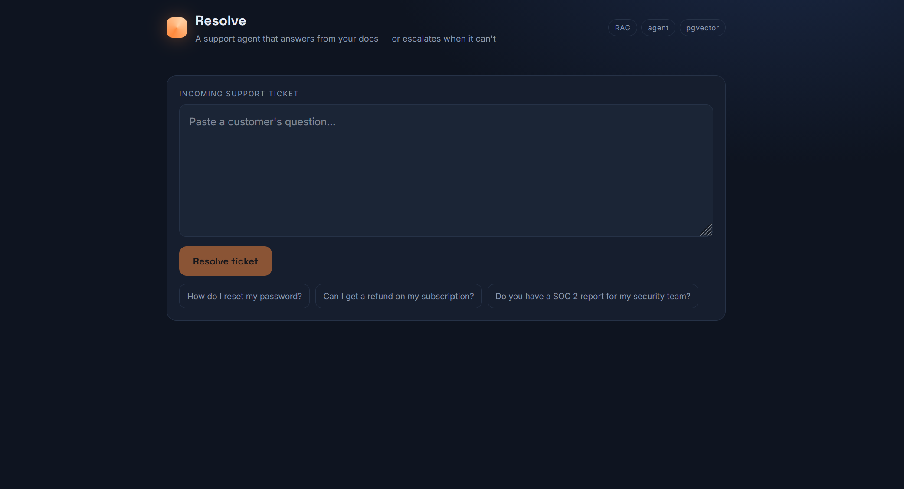
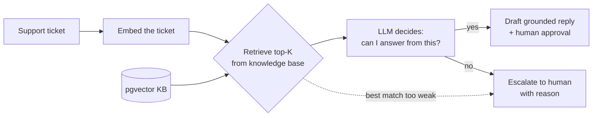

# Resolve — an AI support agent that answers from your docs, or escalates when it can't

Resolve reads an incoming support ticket, searches a knowledge base for the answer, and then makes a decision: if the docs cover it, it drafts a **grounded reply** (a human approves before it goes out); if they don't, it **escalates to a human** instead of inventing an answer.

It's a deliberate combination of two techniques: **RAG** (retrieval over a knowledge base) and an **agent decision** (answer-vs-escalate) — the shape most real internal AI support tools take.

**Live demo:** https://support-resolver.vercel.app/  ·  **Author:** [Hamza Abubakar](https://github.com/hamzaamughal)

<!-- Replace with a screenshot showing one auto-answer and one escalation, with the source bars visible -->

---

## What makes this more than a chatbot

Most support bots answer everything — including questions they have no real information about, which is how customers get confidently wrong answers. Resolve is built around the opposite principle: **it knows when it doesn't know.**

- **Grounded answers only.** Replies are generated strictly from retrieved knowledge-base passages, never from the model's general memory.
- **Answer or escalate.** The agent judges whether the retrieved context actually covers the ticket. If not, it routes to a human with a reason.
- **Defense in depth.** The model makes the judgment, but a deterministic code guard overrides it: if retrieval is too weak (no sufficiently relevant passage), the ticket is escalated regardless of what the model claims.
- **Human in the loop.** Even on an answerable ticket, a person approves the draft before it's sent.
- **Visible reasoning.** Every result shows the knowledge-base passages considered and their relevance scores, so you can see *why* it answered or escalated.

## How it works

1. **Retrieve** — the ticket is embedded and the most relevant knowledge-base chunks are pulled from Postgres via pgvector cosine search.
2. **Decide** — the model, using structured output, returns whether it can answer, a grounded draft (or an escalation reason), a category, and a confidence score — constrained to only use the retrieved context.
3. **Backstop** — if the closest retrieved chunk is beyond a distance threshold, the ticket is force-escalated in code, so a weak retrieval can never produce a hallucinated answer.
4. **Approve** — answerable tickets show an editable draft with an approval gate; delivery is a pluggable step.

## Example questions to try

The demo ships with a small knowledge base for a fictional product ("Beacon") covering **billing & refunds, account & login, and integrations & data**. Try these:

**These get answered (covered by the KB):**
- "How do I reset my password?"
- "Can I get a refund on my subscription?"
- "What plans do you offer and how much are they?"
- "How do I export my data?"
- "Which integrations do you support?"

**These get escalated (deliberately NOT in the KB):**
- "Do you have a SOC 2 report I can send to my security team?"
- "Can you sign a custom enterprise contract?"
- "Where is my data physically stored?"

The contrast is the point: the same system answers what it can and hands off what it can't. To make it answer new topics, just add documents to the knowledge base — no code changes.

## Tech stack

| Layer | Choice |
|---|---|
| Framework | Next.js (App Router) |
| AI orchestration | Vercel AI SDK (`ai`, `@ai-sdk/openai`) |
| Structured decision | `generateObject` + Zod schema |
| Embeddings | OpenAI `text-embedding-3-small` |
| Reasoning / drafting | OpenAI `gpt-4o-mini` |
| Vector store | Postgres + `pgvector` (Neon), HNSW index |
| Hosting | Vercel |

---

## Design decisions & limitations

- **Why escalate at all?** A support tool that always answers is a liability — it will confidently make up policy. Escalation is the feature that makes it trustworthy, and the deterministic distance backstop is what makes escalation *reliable* rather than dependent on the model's self-assessment.
- **Why `generateObject` instead of an autonomous tool loop?** For a human-approval workflow you want the agent to *propose* a structured decision you can render and gate — not to fire actions on its own. Structured output gives typed, predictable results.
- **Delivery is intentionally a stub.** Sending depends on the target helpdesk (Zendesk, Intercom, email). The approval gate is implemented; wiring a specific delivery channel is a drop-in step behind the same interface.
- **Retrieval quality bounds everything.** The escalate threshold and chunking strategy are the main tuning levers. Next steps: re-ranking the retrieved candidates, hybrid keyword+semantic search, and per-document access controls.

## Author

Built by **Hamza Abubakar** — Senior Full Stack Engineer.
[GitHub](https://github.com/hamzaamughal) · [LinkedIn](https://linkedin.com/in/hamza-abubakar) · [Portfolio](https://hamzaabubakar.dev/)
